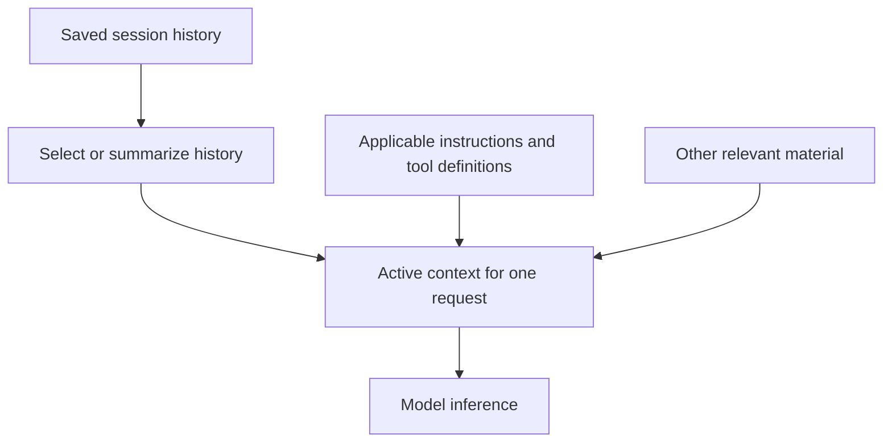

# Session history is not active context

The **session** is the ongoing interaction and associated state. The **active context** is the information supplied for a particular model inference request. Storing an earlier message does not guarantee that the model can currently see it.

## What differs

|          | Session history                                                | Active context                                                                     |
| -------- | -------------------------------------------------------------- | ---------------------------------------------------------------------------------- |
| Purpose  | Preserve the conversation and associated state                 | Supply information for the next inference request                                  |
| Contents | May include messages, tool calls, results, and saved artifacts | Selected instructions, tool definitions, messages, file contents, and tool results |
| Limit    | Product storage and retention rules                            | The model's context window and API limits                                          |

The context window has a finite token budget, with room needed for generated output; exact accounting varies by model and API. A harness may select history, truncate large results, or summarize older exchanges to stay within it. Summarization is often called **compaction** and can lose details.

For example, a saved session may contain a long debugging log while the next model request includes only a summary of the failure. The original log and its summary can have different detail, but both may still contain sensitive information.

This illustrates one possible way a harness builds a request. The stored history can remain even when only a selection or summary is sent.

## Who manages continuity?

A harness typically manages the conversation, pending tool calls, and saved artifacts, locally or through remote services. With a stateless API, the application supplies the needed history on each request. Some APIs also offer stored conversation state or references to previous responses.

These are ways of supplying context, not updates to model weights. Avoid assuming that every API is stateless, every session is local, or compaction deletes the original history.

## Sources and applications

- [OpenAI: Conversation state](https://developers.openai.com/api/docs/guides/conversation-state) — manual history and API-managed state.
- [Anthropic: How Claude Code works](https://code.claude.com/docs/en/how-claude-code-works#work-with-sessions) — an implementation illustrating saved sessions and compaction.
- Applied in [How models and harnesses interact](../pages/model-harness-interaction.md) and [the data-flow checklist](../pages/agent-data-flow-checklist.md).
