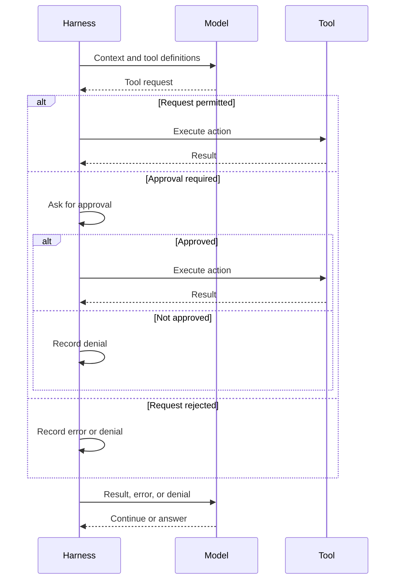

# The model requests; the harness acts

A language model does not execute a tool merely by generating a request for it. The harness or connected execution service performs the action and returns its result.

[View the short slide](../slides/tool-call-loop.md).

## The loop

1. The harness supplies instructions, relevant context, and definitions of available tools.
2. The model generates an answer or a structured tool request.
3. The harness checks the request against its validation and permission rules, then executes it, asks for approval, or returns an error or denial.
4. The harness includes the result in a subsequent model request.
5. The model uses that information to continue, potentially requesting more tools before answering.

A tool definition typically describes a name, purpose, and argument schema, often using JSON Schema. The model needs this interface, not the tool's implementation. Tool-call identifiers associate results with requests.

The following illustrates one possible request and response; permission handling varies by harness.



## Example

This is an illustrative exchange, not a particular provider's wire format:

```text
Harness -> Model:
  User: What files are in the project root?
  Tool: list_files(path: string) lists entries in a directory.

Model -> Harness:
  Tool call: id="call-1", name="list_files", arguments={"path":"."}

Harness:
  Checks the request and runs the tool.

Harness -> Model:
  Tool result: call_id="call-1", entries=["README.md", "src/"]

Model -> Harness:
  Assistant message: The root contains README.md and src/.

Harness -> User:
  Displays the assistant message.
```

One user turn can involve many model requests. Tools may execute locally or remotely; permission checks and result handling vary by harness. MCP standardizes host/server communication, not the model provider's message format.

## Sources and applications

- [OpenAI: Unrolling the Codex agent loop](https://openai.com/index/unrolling-the-codex-agent-loop/) — the request/action/result loop and concrete tool definitions.
- [MCP architecture](https://modelcontextprotocol.io/docs/learn/architecture) — the host, client, and server relationship.
- Applied in [How models and harnesses interact](../pages/model-harness-interaction.md) and [Sensitive data in agent workflows](../pages/sensitive-data-in-agent-workflows.md).
