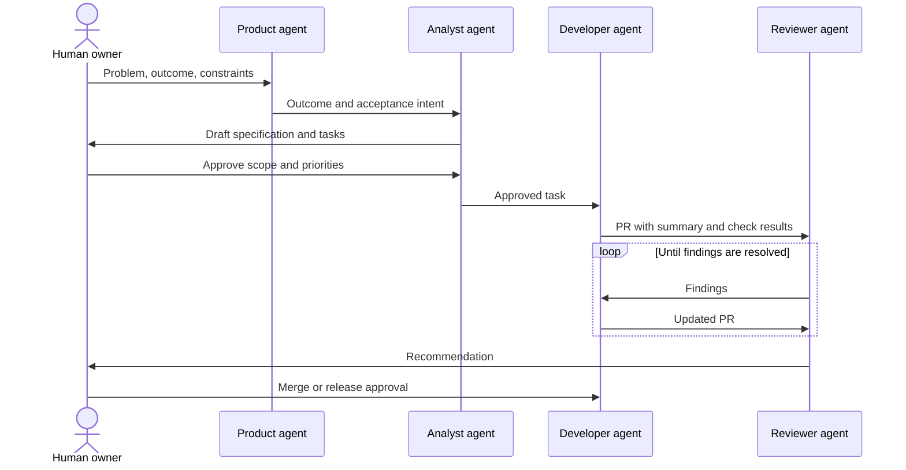

# Agile roles in agentic development

[Add an agent role](../concepts/skills-profiles-and-tools.md) only when repeated work and reviewable handoffs justify the extra coordination. This page shows one possible workflow, not a standard arrangement or evidence that it performs better; the [lo-fi software factory case study](lo-fi-software-factory-case-study.md) records one attempt.

Four roles illustrate the division: a **Product** agent explores requirements, a **Business Analyst** turns approved decisions into tasks, a **Developer** implements them, and a **Reviewer** independently examines the changes. A human retains authority over scope and release. Each additional handoff needs a clear deliverable.

For how to define a role contract and restrict a Copilot custom agent's tools, see [Agent roles](../concepts/skills-profiles-and-tools.md). The original four role files, and their use of skills, are examined in [How agent roles use skills](../reference/agent-roles-directory.md).

## Example responsibilities

This deliberately small RACI table shows the important handoffs, not every activity a team performs. The letters mean:

- **R**esponsible: does the work
- **A**ccountable: answers for the result
- **C**onsulted: gives input before the work is done
- **I**nformed: is told the outcome

| Activity                              | Product | Analyst | Developer | Reviewer | Human |
| ------------------------------------- | :-----: | :-----: | :-------: | :------: | :---: |
| Clarify problem and acceptance intent |    R    |    C    |     I     |    I     |   A   |
| Approve specification and scope       |    C    |    C    |     I     |    I     |  R/A  |
| Implement, test and open PR           |    I    |    C    |     R     |    I     |   A   |
| Review PR and report findings         |    I    |    I    |     C     |    R     |   A   |
| Approve merge or release              |    C    |    I    |     I     |    C     |  R/A  |

## The handoffs

Roles prepare work and recommend; the human decides and stays accountable. Copilot custom-agent instructions cannot enforce approvals on their own. Keep independent [review and approval controls](../goals/traceability/accountable-approval.md) around the pull request.

## Sources

- [GitHub Docs: About custom agents](https://docs.github.com/en/copilot/concepts/agents/cloud-agent/about-custom-agents)
- [GitHub Docs: Custom agents configuration](https://docs.github.com/en/copilot/reference/custom-agents-configuration)
