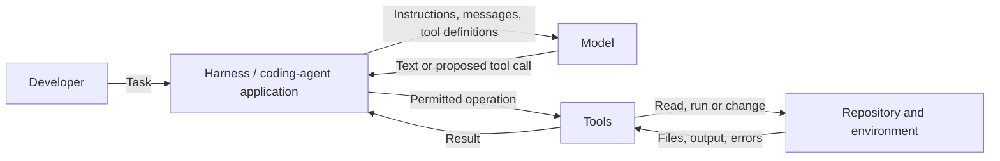

# Inside a coding agent

When Copilot appears to run a test, the language model has not opened a shell. The **model** generates a request; the **harness** interprets it and arranges the work. Those two components, together with tools and an execution environment, form the coding-agent system.

## The components

- **Model:** consumes a request and generates text or structured output, including tool requests. It does not directly read your disk or run a command.
- **Harness:** the surrounding application, such as Copilot CLI. It assembles model input, exposes tool interfaces, handles tool requests, manages the interaction and applies permission controls.
- **Tools:** operations such as reading a file, running a shell command or calling an MCP server. A tool may execute locally or through a remote service.
- **Environment:** the repository, filesystem, processes, credentials and services a permitted tool can reach.
- **Instructions and context:** information provided to the model, not independent enforcement mechanisms. The harness decides what is supplied in each request.

Here, **agent** means the task-performing combination. Product documentation sometimes uses the word for a narrower component.

## Who talks to whom?



The model-to-harness arrow is **not** an arrow into your shell. The harness decides whether to execute a requested operation, seek approval or refuse it. A prompt asking the model not to do something is not a substitute for a permission boundary.

## Where capabilities come from

Suppose the developer asks, “Fix the failing test.” The model may be able to reason about source code, but whether it can inspect that code depends on what is in its current input and which tools the harness offers. Whether it can edit files or run tests depends on the available tools and enforced permissions.

An illustrative tool interface exposed to the model might be:

```json
{
  "name": "run_command",
  "description": "Run a permitted repository command",
  "parameters": {
    "command": "string"
  }
}
```

This describes an available action; it does not include the shell implementation. **Illustrative schema, not a literal Copilot tool definition.** The actual interfaces and approval behaviour vary between Copilot surfaces and other agents.

## Why the boundary matters

Tool output can bring external text and sensitive information back into the model's input. Tools can also alter files or contact services, so enforcement must happen outside the model. See [instructions versus enforced controls](../concepts/instructions-vs-controls.md) and [unexpected data exposure](../goals/security/unexpected-data-exposure.md).

Next, examine [what the model receives and returns](model-requests-and-responses.md): how instructions, tool interfaces and earlier results become a model request.

## Sources

- [GitHub: Copilot CLI configuration and tool permissions](https://docs.github.com/en/copilot/how-tos/copilot-cli/set-up-copilot-cli/configure-copilot-cli)
- [Anthropic: Building effective agents](https://www.anthropic.com/research/building-effective-agents)
- [MCP architecture](https://modelcontextprotocol.io/docs/learn/architecture)
