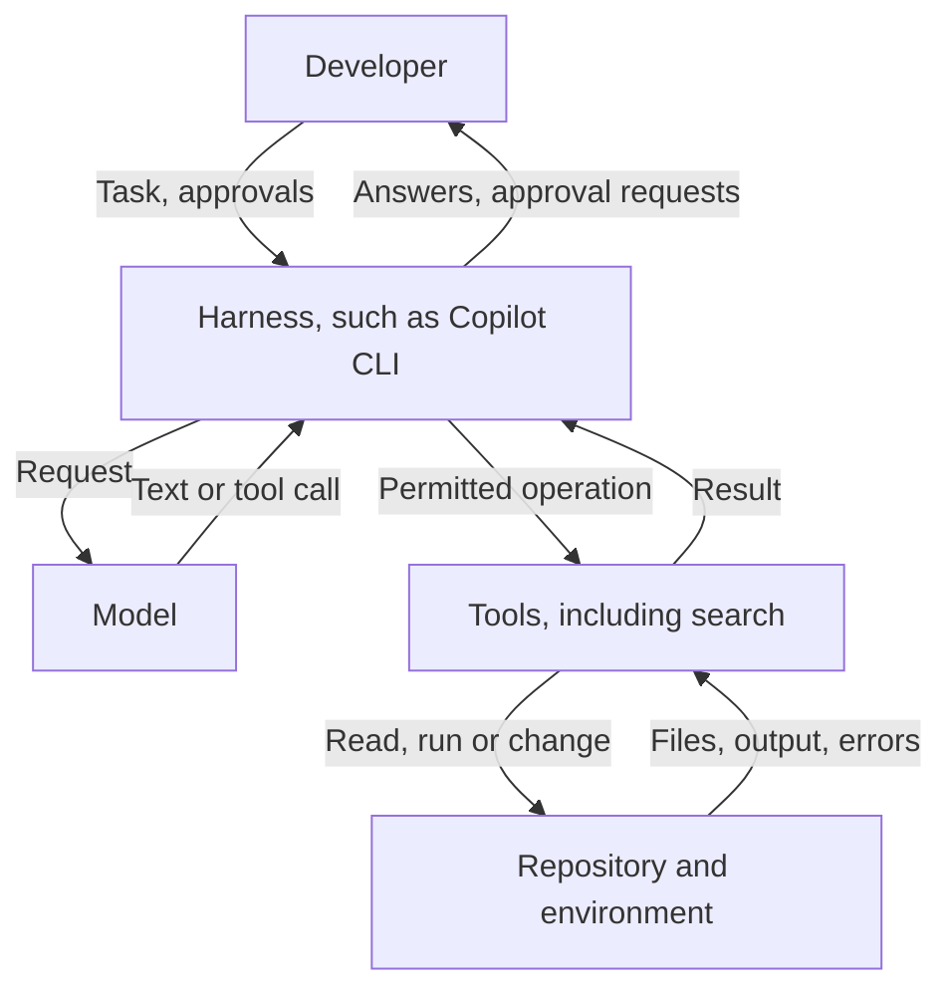

# Inside a coding agent

When Copilot appears to run a test, the language model has not opened a shell. The **model** generates a request; the **harness** interprets it and arranges the work. Those two components, together with tools and an execution environment, form the coding-agent system.

## The components

- **Model:** consumes a request and generates text or [structured output](../reference/glossary.md#structured-output), including tool requests. It does not directly read your disk or run a command.
- **Harness:** the surrounding application, such as Copilot CLI. It assembles model input, exposes tool interfaces, handles tool requests, manages the interaction and applies permission controls.
- **Tools:** operations such as searching code, reading a file, running a shell command or calling an [MCP](../reference/glossary.md#model-context-protocol-mcp) server. A tool may execute locally or through a remote service.
- **Environment:** the repository, filesystem, processes, credentials and services a permitted tool can reach.
- **Instructions and context:** information provided to the model, not independent enforcement mechanisms. The harness decides what is supplied in each request.

In this article, **coding agent** means the complete system: the model, harness, tools and execution environment.

## Who talks to whom?



The model-to-harness arrow is **not** an arrow into your shell. The harness decides whether to execute a requested operation, seek approval or refuse it. A prompt asking the model not to do something is not a substitute for a permission boundary.

## Where capabilities come from

Suppose the developer asks, “Fix the failing test.” The model may be able to reason about source code, but whether it can inspect that code depends on what is in its current input and which tools the harness offers. Whether it can edit files or run tests depends on the available tools and enforced permissions.

A tool definition tells the model which operation it can request. A simplified example; real definitions vary by product:

```json
{
  "name": "run_command",
  "description": "Run a permitted repository command",
  "parameters": {
    "command": "string"
  }
}
```

The interface describes an action, not how the shell tool is implemented. Copilot surfaces can expose different tools and approval rules.

## How the agent finds task-related code

The agent needs task-related code in the model's input, not just somewhere on disk. Two routes are possible:

- **Agent-directed search:** the model requests a search tool, such as text search or semantic code search; the harness returns matching files or excerpts, which can inform another model call.
- **Automatic retrieval:** the harness or a retrieval component selects matching repository passages before a model call, without the model separately requesting each search.

These are alternative patterns that a product can combine. **Neither requires a vector database.** Search may use filenames, symbols, text matches or [embeddings](../reference/glossary.md#embedding)-based semantic similarity. Retrieval-augmented generation (RAG) means supplying retrieved material to a model; vector search is one possible retrieval mechanism. See [RAG](../concepts/retrieval-augmented-generation.md) and [vector stores](../concepts/retrieval-augmented-generation.md#vector-search) for those distinct concepts.

The choice affects what the model can discover and the costs of indexing or further tool and model calls. Automatic retrieval is a possible arrangement, not a claim that every Copilot surface retrieves context automatically.

## Why the boundary matters

Tool output can bring external text and sensitive information back into the model's input. Tools can also alter files or contact services, so enforcement must happen outside the model. See [instructions and enforced controls](../concepts/instructions-vs-controls.md) and [unexpected data exposure](../goals/security/unexpected-data-exposure.md).

Next, examine [what the model receives and returns](model-requests-and-responses.md): how instructions, tool interfaces and earlier results become a model request.

## Sources

- [GitHub: Copilot CLI configuration and tool permissions](https://docs.github.com/en/copilot/how-tos/copilot-cli/set-up-copilot-cli/configure-copilot-cli)
- [Anthropic: Building effective agents](https://www.anthropic.com/research/building-effective-agents)
- [MCP architecture](https://modelcontextprotocol.io/docs/learn/architecture)
- [GitHub: Repository indexing for Copilot](https://docs.github.com/en/copilot/concepts/prompting-and-context/repository-indexing)
- [VS Code: How Copilot understands your workspace](https://code.visualstudio.com/docs/agents/reference/workspace-context)
