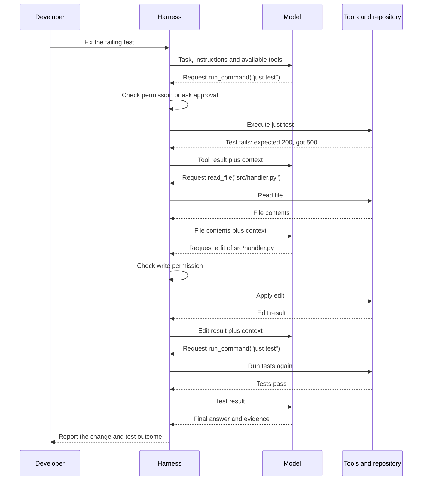

# How a coding agent carries out a task

One developer request can trigger several model calls. After each call, the harness may execute a permitted tool, return the result, and ask the model what to do next. That repeating exchange is the **agent loop**.

This is the third part of [understanding how coding agents work](../articles/understanding-coding-agents.md). The earlier parts explain [the components](../articles/inside-coding-agent.md) and [the request payloads](../articles/model-requests-and-responses.md).

## Follow a failing test

Suppose you ask, “Fix the failing test.” The following sequence is **illustrative**, not a captured Copilot session:

The model does not execute the test or the edit. It requests actions from the harness, which applies its permission rules and invokes tools. Some actions may require your approval or be denied. A tool result can enter the next model request as evidence, even though its contents may be untrusted.

## How observations change the next action

The first test failure tells the model _what happened_, not necessarily _why_. Its next action might be to search for the failing assertion, read the handler, inspect recent changes or run a narrower test. The model can choose among available tools, and the harness returns the observations.

If the first edit fails, the loop may continue: inspect the new error, revise a hypothesis, edit again and rerun checks. A tool refusal can also lead the model to choose another permitted route or ask you for help. An agent does not have to follow a fixed script, and a final answer may be produced without a tool call.

## A smaller view of one tool handoff

<!-- include -->

[Diagram: a tool call, from the model's request to the harness's decision and back](../includes/tool-call-loop-diagram.md)

<!-- include -->

[Copilot CLI: where the harness's check appears](../includes/tool-call-loop-copilot-cli.md)

[View the short slide](../slides/tool-call-loop.md).

This boundary is why enforceable limits belong in the harness, not just in a prompt. It is also where file contents and tool results can re-enter model context; see [unexpected data exposure](../goals/security/unexpected-data-exposure.md).

## What this reveals about cost and trust

Each round can add tool execution time and another model call, with new input and output tokens. Repository search may be a useful tool request, or the harness may use retrieval to supply matching files before a call; see [inside a coding agent](../articles/inside-coding-agent.md#how-the-agent-finds-task-related-code).

Passing tests is evidence that those checks succeeded in that environment. It does not prove that the developer's underlying requirement has been met. The agent's final explanation is likewise a report to review, not an independent record of everything it did. See [define, steer and verify a task](../goals/alignment/define-and-verify-tasks.md).

## Sources

- [GitHub Docs: Configuring Copilot CLI](https://docs.github.com/en/copilot/how-tos/copilot-cli/set-up-copilot-cli/configure-copilot-cli)
- [MCP architecture](https://modelcontextprotocol.io/docs/learn/architecture)
- [OpenAI: Unrolling the Codex agent loop](https://openai.com/index/unrolling-the-codex-agent-loop/)
