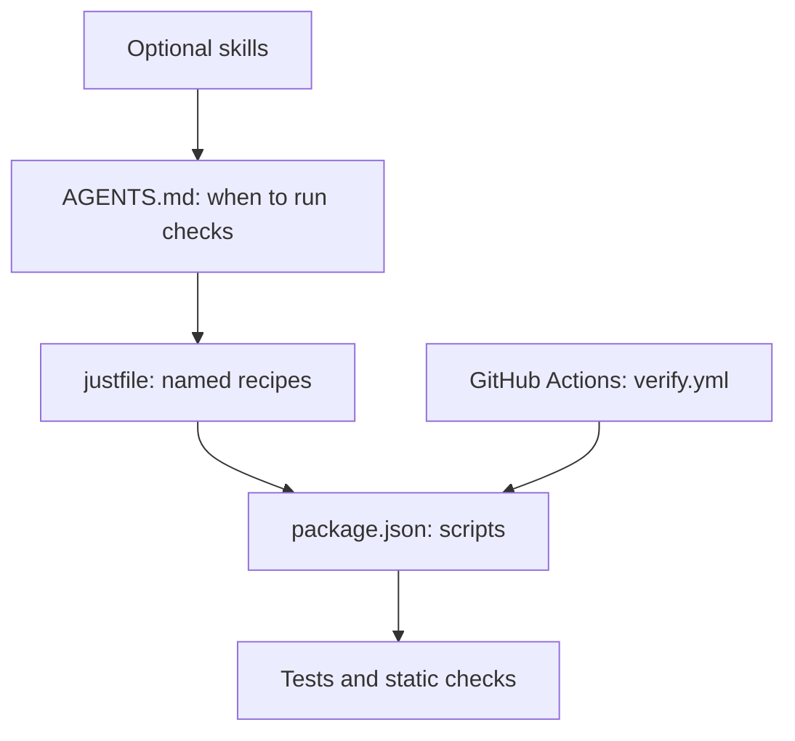

# A structure for agent-facing repositories

Start with `AGENTS.md` and your existing commands. Add the other pieces below only when a recurring problem calls for them, because each file is one more thing to keep in step with the code; this is a map, not a setup checklist.

```text
repo/
├── AGENTS.md                         # Shared instructions for every agent
├── justfile                          # Optional task runner
├── package.json                      # Example: scripts called by the runner
├── scripts/                          # Checks implemented in the repository
├── tests/                            # Behaviour checks
├── .agents/
│   └── skills/
│       └── <skill-name>/
│           └── SKILL.md              # Plus optional scripts/, references/, assets/
├── docs/
│   ├── architecture/                 # Canonical project documentation
│   └── agents/                       # Reference written for agents
│       └── README.md                 # Index, once there are several pages
└── .github/
    ├── copilot-instructions.md       # Only for Copilot features that don't read AGENTS.md
    ├── instructions/<scope>.instructions.md
    ├── agents/<role>.agent.md        # Copilot custom agents
    ├── prompts/<task>.prompt.md      # Reusable prompts, in editors that support them
    └── workflows/
        ├── verify.yml               # Runs repository checks in CI
        └── copilot-setup-steps.yml   # Dependencies for the Copilot cloud agent
```

## What goes where

| Path                                        | What it is for                                                 | Details                                                                                                               |
| ------------------------------------------- | -------------------------------------------------------------- | --------------------------------------------------------------------------------------------------------------------- |
| `AGENTS.md`                                 | What every agent needs in every task                           | [Write repository instructions in AGENTS.md](repository-instructions.md)                                              |
| `.github/copilot-instructions.md`           | The same essentials for Copilot features that skip `AGENTS.md` | [Fill Copilot's gaps](repository-instructions.md#fill-copilots-gaps)                                                  |
| `.github/instructions/`                     | Rules for one part of the codebase                             | [Add rules for one part of the codebase](repository-instructions.md#add-rules-for-one-part-of-the-codebase)           |
| `.agents/skills/`                           | Procedures loaded only when a task needs them                  | [Choose and add skills](../economy/useful-skills.md)                                                                  |
| `.github/agents/`                           | Roles with their own tools and limits                          | [Skills, profiles, and tools](../../concepts/skills-profiles-and-tools.md)                                            |
| `justfile` or package scripts               | Named commands for testing and checking the repository         | [Enable agents to run repository commands](agent-tool-delegation.md)                                                  |
| `.github/workflows/copilot-setup-steps.yml` | Installing dependencies for the cloud agent                    | [Give the cloud agent what it needs](agent-tool-delegation.md#give-the-copilot-cloud-agent-what-it-needs-to-run-them) |
| `docs/`                                     | Domain, architecture, and decisions                            | [Repository context for agents](repository-context-for-agents.md)                                                     |

## `docs/agents/`

Use `docs/agents/` only for material written for agents, such as issue-tracker conventions, tooling notes, or findings from recurring investigations. Keep ordinary project documentation where it already lives under `docs/`, and link to it from `AGENTS.md`. A document does not belong here just because an agent reads it; two homes for the same information drift apart.

Keep `.github/workflows/` for automation, not as a second home for agent instructions.

## How instructions connect to checks

The tree illustrates where files might live; the key relationship is that instructions point to commands backed by executable checks. For example, in a Node.js repository:



`AGENTS.md` tells the agent which commands to run, the task runner and scripts implement them, and CI runs the checks independently. A passing agent report is not a substitute for the checks actually running. The optional-skills arrow shows that skills complement instructions, not that the contents of `.agents/skills/` are automatically loaded; discovery depends on the agent.

## Real repositories to inspect

- [This wiki's AGENTS.md](https://github.com/ho-henry-senior/ai-wiki/blob/main/AGENTS.md), [justfile](https://github.com/ho-henry-senior/ai-wiki/blob/main/justfile), [package.json](https://github.com/ho-henry-senior/ai-wiki/blob/main/package.json) and [Verify workflow](https://github.com/ho-henry-senior/ai-wiki/blob/main/.github/workflows/verify.yml) demonstrate that chain.
- [Awesome Copilot's AGENTS.md](https://github.com/github/awesome-copilot/blob/main/AGENTS.md) shows a different arrangement of instructions, skills, agent profiles, hooks and workflows.

Start with your existing commands and documentation. Add agent-specific directories only when there is real material to put in them. Use the relationships, not the directory names, as a starting point. For why instructions do not enforce permissions, see [instructions and enforced controls](../../concepts/instructions-vs-controls.md).
