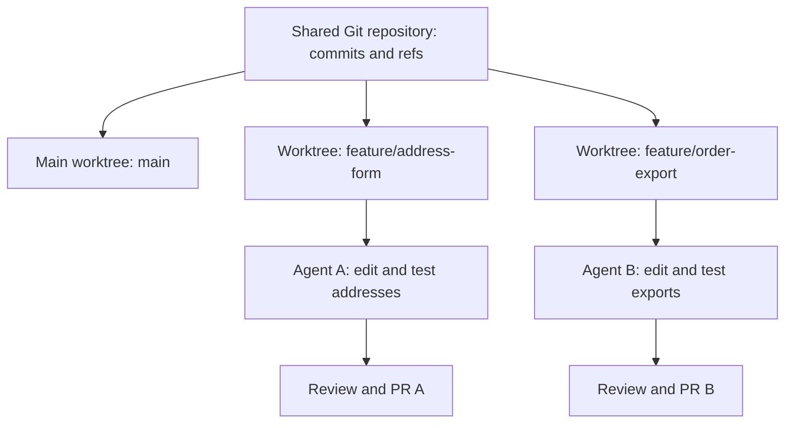

# Git worktrees for parallel agent work

A **Git worktree** is another working directory linked to the same Git repository. It has its own checked-out files, index and usually its own branch, while sharing the repository's commits and most Git metadata. You can work on two branches at once without repeatedly switching the files in one directory.

This is valuable when local coding agents work on independent tasks: each agent can edit, run tests and inspect its own diff without overwriting another agent's uncommitted changes. It also works for a developer running a test branch alongside ongoing work.

## Create and use worktrees

From an existing checkout of a repository named `shop`, create a separate directory for an address-form task:

```sh
git worktree add -b feature/address-form ../shop-address-form main
git worktree list
cd ../shop-address-form
git status
```

The first command creates the branch `feature/address-form` from local `main` and checks it out in `../shop-address-form`. Start a local Copilot CLI or editor agent session in that directory, give it the address-form issue, and run that project's checks there. Start a second session for another task in a different worktree and branch:

```sh
git worktree add -b feature/order-export ../shop-order-export main
```

These are separate directories, **not separate repository clones**. Git generally prevents the same branch from being checked out in two worktrees at once. Choose distinct task branches and confirm the base branch contains the revision you want before creating them.



Each agent works in its own directory, with shared repository history.

## Finish a task

Review changes and run the required checks **in each worktree** before committing and opening its pull request. Each branch can then be reviewed and merged normally. After the worktree has no changes you need to retain and the task is finished:

```sh
cd ../shop
git worktree remove ../shop-address-form
git branch -d feature/address-form
git worktree list
```

The branch deletion is optional; use it only after the branch is merged or otherwise no longer needed. By default, `git worktree remove` refuses to remove a worktree containing uncommitted changes, and `git branch -d` checks that the branch is merged. Do not force either command just to make cleanup succeed.

## Shared state and concurrent changes

Worktrees share Git history and repository metadata. Concurrent tasks may also use the same database, ports or generated files outside their working directories. Install dependencies and set up ignored build artefacts in each directory as needed.

Parallel branches can still introduce conflicting or incompatible changes to the same feature. Prefer distinct tasks and test the combined result after merging.

## Source

- [Git: git-worktree manual](https://git-scm.com/docs/git-worktree) — creation, listing, removal, shared metadata and branch behaviour.
