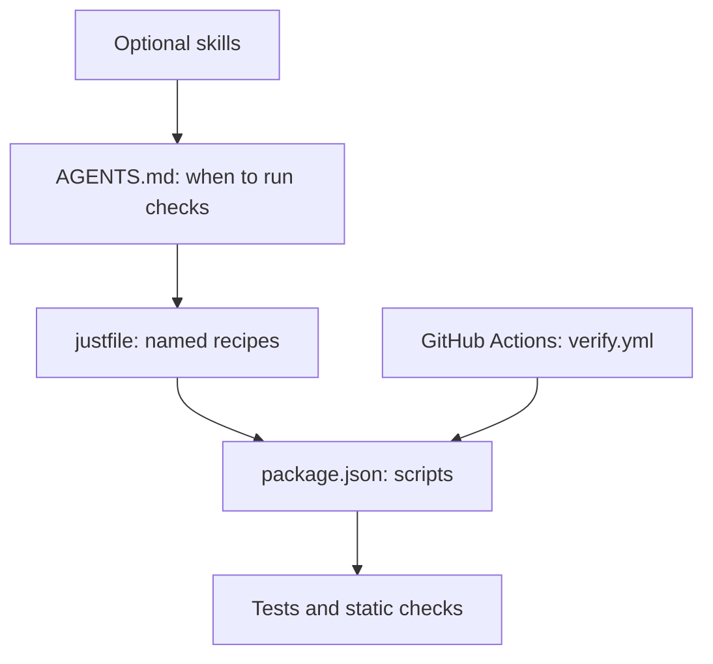

# Repository layout example: instructions to checks

**Use this asset** to see how a repository can connect an agent's instructions, executable verification and CI. This layout is **illustrative**, modelled on files in this wiki; it is not a required directory scheme.

## Directory tree

```text
project/
├── AGENTS.md                 # What to do and where to find context
├── justfile                  # Named commands
├── package.json              # Implements the commands
├── scripts/                  # Verification logic
├── tests/                    # Behaviour checks
├── docs/                     # Project decisions and architecture
├── .agents/
│   └── skills/               # Optional task-specific procedures
└── .github/
    └── workflows/
        └── verify.yml        # Runs the checks in CI
```

`AGENTS.md` names commands; `justfile` gives them short, stable names; tests and scripts define the checks. CI must run the actual checks independently, not trust an agent's report that they passed.

## How the files connect



The optional-skills arrow indicates that skills complement repository instructions, **not** that a skills directory automatically loads every procedure. Tools may discover skills according to their own rules.

## Real repositories to inspect

- [This wiki's AGENTS.md](https://github.com/ho-henry-senior/ai-wiki/blob/main/AGENTS.md), [justfile](https://github.com/ho-henry-senior/ai-wiki/blob/main/justfile), [package.json](https://github.com/ho-henry-senior/ai-wiki/blob/main/package.json) and [Verify workflow](https://github.com/ho-henry-senior/ai-wiki/blob/main/.github/workflows/verify.yml) — a connected implementation of this chain.
- [Awesome Copilot's AGENTS.md](https://github.com/github/awesome-copilot/blob/main/AGENTS.md) — a different layout that groups instructions, skills, agent profiles, hooks and workflows by their roles.

Start with the commands your project already has. Add agent-specific directories only when there is real material to put in them. For placement decisions, see [a structure for agent-facing repositories](../goals/alignment/agent-facing-repository-structure.md). For security, [instructions are not enforced controls](../concepts/instructions-vs-controls.md).
