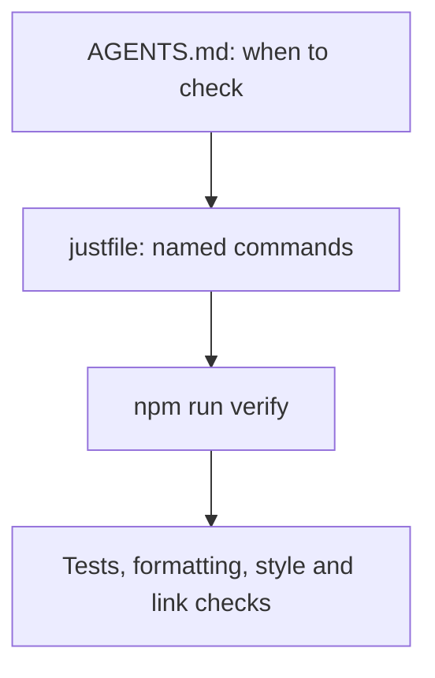

# Real agent-ready repository examples: candidate research

This is a bounded source review for [issue #124](https://github.com/ho-henry-senior/ai-wiki/issues/124), not yet a public examples catalogue. The purpose is to choose **real files that illustrate transferable practices** before building Reference pages. The files below were read from their public GitHub repositories on 2026-11-18; the linked default branches may change. No third-party code or instructions were executed.

## First collection: eight examples worth presenting

| Example and exact source | What a reader can learn | What not to copy blindly |
| --- | --- | --- |
| [This wiki's justfile](https://github.com/ho-henry-senior/ai-wiki/blob/main/justfile) | Small, discoverable interface: `default` lists tasks, `verify` is a read-only gate, `format` changes files, and site tasks are separate. | Commands assume this site's Node.js and Just tooling; use it to explain the distinction between checks and fixes, not to prescribe a runner. |
| [Just's own justfile](https://github.com/casey/just/blob/master/justfile) | A mature alternative: grouped recipes, named test filters, check composition, and development versus release commands. | This is a larger Rust project; its release/publish recipes are high-impact. Check the current default branch if the linked path moves. |
| [VS Code's AGENTS.md](https://github.com/microsoft/vscode/blob/main/AGENTS.md) | A *very short* entrypoint that points to more detailed project guidance and adds one specific cross-cutting rule. | An agent must discover and follow the referenced file; the link alone does not enforce anything. Inspect the associated [Copilot instructions](https://github.com/microsoft/vscode/blob/main/.github/copilot-instructions.md) before adopting the approach. |
| [Next.js AGENTS.md](https://github.com/vercel/next.js/blob/canary/AGENTS.md) | Detailed monorepo map, path-specific reading guidance, concrete build and test commands and descriptions of major packages. | Its long root instructions are a **contrast**, not a model for every project: a large file consumes more context and can become stale. Check its branch and commands before adapting. |
| [GitHub Agentic Workflows AGENTS.md](https://github.com/github/gh-aw/blob/main/AGENTS.md) | Distinguishes command-line tools, states verification and handoff rules, and directs agents to load task-specific context only when needed. | Its named commands, workflow-specific constraints and handoff tooling are repository-specific. |
| [Awesome Copilot AGENTS.md](https://github.com/github/awesome-copilot/blob/main/AGENTS.md) | Maps different agent-related resources (agents, instructions, skills, hooks and workflows) to directories and describes commands for maintaining them. | Its structure serves a *catalogue of reusable agent resources*, not a standard application. Copy its navigation idea, not necessarily its directory tree. |
| [Awesome Copilot's docs-sync-audit skill](https://github.com/github/awesome-copilot/blob/main/skills/docs-sync-audit/SKILL.md) | A scoped audit skill that distinguishes confirmed documentation drift from inferred gaps, and treats inspected content as untrusted. | The skill has its own procedures and script; listing it is **not** an endorsement to install or execute it without reviewing the full package. |
| [Anthropic's doc-coauthoring skill](https://github.com/anthropics/skills/blob/main/skills/doc-coauthoring/SKILL.md) | A task-focused `SKILL.md` with explicit stages and reader-testing rather than permanent repository-wide instructions. | The workflow is designed for document drafting; it is not a repository-validation skill. Review applicability and bundled resources before use. |

For the initial publication, group these by **Justfiles and command interfaces**, **AGENTS.md and repository maps**, and **skills and complete setups**. A reader should be able to navigate by the job the example solves, not only by file extension.

## Two valuable contrasts to retain in the research

- [Model Context Protocol reference servers' AGENTS.md](https://github.com/modelcontextprotocol/servers/blob/main/AGENTS.md) separates always-visible rules from procedures in `.claude/skills/`. It is extensive (over 50 KB at inspection): useful for studying the boundary between instructions and skills, but too large to recommend as a first example without focused excerpts.
- [Pydantic's Makefile](https://github.com/pydantic/pydantic/blob/main/Makefile) documents setup and validation targets using Make rather than Just. It illustrates the transferable principle that **existing task runners can be sufficient**. Keep it as a comparison, not a call to replace Makefiles with Just.

## How the pieces fit together

These are **source-grounded relationships**, not a prescribed layout. The [wiki's own AGENTS.md](https://github.com/ho-henry-senior/ai-wiki/blob/main/AGENTS.md) tells an agent to use `just --list` and `just verify`; its [justfile](https://github.com/ho-henry-senior/ai-wiki/blob/main/justfile) delegates `verify` to `npm run verify`. A future reference entry could use this small Mermaid diagram, with each arrow supported by those files:

For directory-layout examples, [Awesome Copilot's AGENTS.md](https://github.com/github/awesome-copilot/blob/main/AGENTS.md) maps `agents/`, `instructions/`, `skills/`, `hooks/`, `workflows/` and `plugins/` to distinct responsibilities; [Next.js's AGENTS.md](https://github.com/vercel/next.js/blob/canary/AGENTS.md) maps a large mixed-language monorepo instead. The published diagrams should follow the **specific inspected source**, never an invented universal repository structure.

## Publication decisions and open checks

1. **Start with three strong entries:** this wiki's task interface, VS Code's short `AGENTS.md`, and Awesome Copilot's repository map. They make different principles visible with little overlap. Then add Just's own recipes, GitHub Agentic Workflows' instructions, and Next.js as a deliberate long-file contrast.
2. **Treat skills as a separate, smaller group:** inspect all bundled scripts and licences before any executable example or excerpt is recommended; don't assume a marketplace listing is a security assessment.
3. **Use exact-file links and small excerpts only.** Confirm the licence and attribution terms for each excerpt before publication. This research links to source files instead of reproducing their content.
4. **Recheck paths and commands** against the selected revision when creating the published entries. The research records what was read at a point in time; it does not prove those files, commands or product behaviours remain unchanged.
5. **Avoid duplicate explanations.** Link each eventual entry to the existing [Justfile guide](../goals/economy/justfile-agent-workflows.md), [AGENTS.md guidance](../goals/alignment/repository-instructions.md), [agent-facing repository structure](../goals/alignment/agent-facing-repository-structure.md), or [skills guidance](../goals/economy/useful-skills.md).
6. **No automatic endorsement.** A real example can be instructive because of its trade-offs or complexity, not because it is universally best.

The earlier [Justfile patterns research](repository-justfiles.md) already surveyed local Node.js and Python projects. It provides evidence about common command roles but intentionally omits identifying repositories, so it should **not** be presented as a collection of public copyable examples. These linked public candidates complement rather than replace it.

## Coverage and limitations

The sample covers two real Justfiles, several different AGENTS.md strategies, a catalogue-style repository layout, two skills, and one alternative task runner. It is intentionally biased toward public repositories with inspectable agent guidance. It does not establish best practices by frequency, evaluate how agents perform with these files, test the commands, or cover every language and framework. Public GitHub files were read; no installation, execution, external repository licence audit, or end-to-end agent trial was performed.
