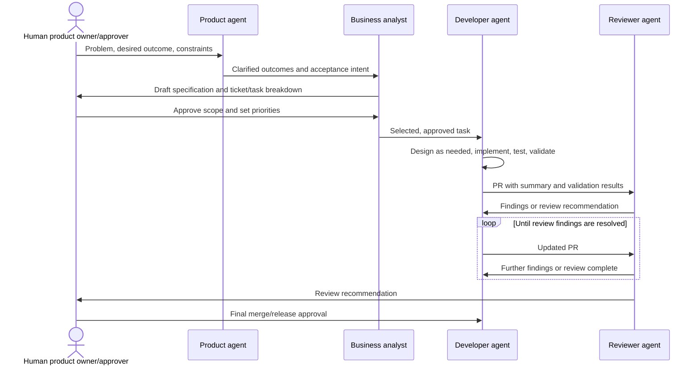

# Define agent role responsibilities and boundaries

An agent role should say both what the agent is expected to do and what is out of bounds. Positive responsibilities alone can leave an agent guessing about adjacent work; prohibitions alone do not give it a useful mandate.

For each role, make explicit:

- **Purpose:** the outcome the role exists to produce.
- **Expected responsibilities:** the work and decisions it owns or contributes to.
- **Limits:** work it must not perform, decisions it cannot make, and conditions that require a handoff.
- **Inputs and outputs:** what it needs and what it should return to the next role.

These boundaries are part of the role's profile or instructions. They should be specific enough to guide behavior, not merely implied by the role title. They are also [instructions, not automatically enforced controls](../concepts/instructions-vs-controls.md); configure tool permissions separately where enforcement matters.

## Use RACI to describe workflow relationships

RACI can map who is **Responsible**, **Accountable**, **Consulted**, and **Informed** for activities across a multi-agent workflow. It helps show ownership and handoffs between roles.

RACI does not, by itself, define every prohibition. An empty cell or an “Informed” assignment does not necessarily mean a role is forbidden to act. State off-limits work directly in the role definition, and use RACI as a complementary workflow view.

For example, a team might define that a product role does not implement code, a reviewer evaluates changes but does not implement them, and a business analyst does not perform code review. These are illustrative boundaries to make explicit, not universal definitions of those roles.

## Example role contracts

These short contracts make the example roles' responsibilities and limits explicit. Adapt them to the work and authority model; they are not canonical definitions.

### Product agent

- **Expected:** clarify the problem, desired outcome, constraints, and acceptance intent; advise on priority.
- **Out of scope:** implementing code, reviewing code, and giving final merge or release approval.
- **Hands off:** an agreed product direction and acceptance intent to the Business Analyst; prioritization decisions to the human product owner.

### Business analyst

- **Expected:** elicit and organize requirements, draft the spec, and decompose approved scope into tickets or tasks.
- **Out of scope:** code review in this workflow.
- **Hands off:** the spec and task breakdown for human approval and prioritization.

### Developer agent

- **Expected:** implement an approved task, add or update tests, run validation, create or update the PR, and address review findings.
- **Out of scope:** changing the agreed product priority or granting final merge or release approval.
- **Hands off:** the PR with a summary and validation results to the Reviewer.

### Reviewer agent

- **Expected:** assess the PR against the requirements and code standards; report findings and a review recommendation.
- **Out of scope:** implementing the change or giving final merge or release approval.
- **Hands off:** the review recommendation to the human approver; findings to the Developer for resolution.

### Human product owner/approver

- **Expected:** set or confirm priorities, approve product scope, and make the final merge or release approval decision.
- **Out of scope:** none prescribed here; the human's responsibilities and any delegated authority should be explicit for each workflow.

## Illustrative delivery-workflow RACI

This example shows one possible division of work, not a prescribed role model. It includes a human product owner/approver because prioritization and final merge/release approval remain human-led here. Adapt the assignments to the actual workflow and authority model.

**R** = Responsible for doing the work; **A** = Accountable for the outcome; **C** = Consulted; **I** = Informed. A blank means “not assigned in this example,” not “prohibited.” State prohibitions in the role profile.

| Activity                                                | Product agent | Business analyst | Developer agent | Reviewer agent | Human product owner/approver |
| ------------------------------------------------------- | ------------- | ---------------- | --------------- | -------------- | ---------------------------- |
| Clarify problem, desired outcome, and acceptance intent | R             | C                | I               | I              | A                            |
| Elicit requirements and draft the spec                  | C             | R                | C               | I              | A                            |
| Approve the spec and scope                              | C             | C                | I               | I              | R/A                          |
| Decompose approved scope into tickets/tasks             | C             | R/A              | C               | I              | I                            |
| Prioritize and assign work                              | C             | C                | I               | I              | R/A                          |
| Propose technical design or an ADR, when needed         | C             | C                | R               | I              | A                            |
| Implement the task and tests                            | I             | C                | R/A             | I              | I                            |
| Run validation and report results                       | I             | I                | R/A             | I              | I                            |
| Create or update the PR                                 | I             | I                | R/A             | I              | I                            |
| Review the PR against requirements and code standards   | I             | I                | C               | R/A            | I                            |
| Address review findings                                 | I             | I                | R/A             | C              | I                            |
| Approve merge/release                                   | C             | I                | I               | C              | R/A                          |

This example keeps the Product agent focused on outcomes rather than implementation, the Business Analyst on requirements and decomposition rather than code review, and the Reviewer on assessment rather than implementation. Review must check the requirements as well as test output: [passing tests are evidence, not proof](../concepts/tests-are-evidence.md). The human retains prioritization and final approval. Repositories may assign the mechanics of merging or releasing separately according to their policies.

## Illustrative handoff flow

The sequence diagram shows the order of work and review loop; the RACI table shows activity ownership. The diagram is Mermaid source so agents can inspect the relationships directly, in addition to the rendered view.

The flow is illustrative: task selection, merge execution, and release mechanics may differ by repository. The explicit role limits still apply even where the diagram omits a role from a handoff.

## Keep responsibility and authority clear

For consequential decisions, distinguish doing the work from having authority to approve it. A role may prepare an analysis or recommendation without being the final decision-maker. Make the accountable person or role and any required human handoff explicit.

See [Skills and agent profiles](skills-and-agent-profiles.md) for how role profiles relate to reusable skills.
