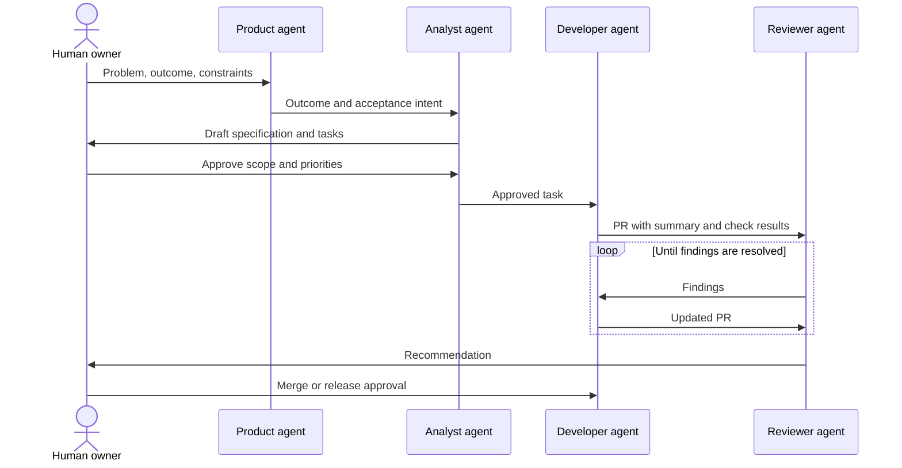

# From agile roles to agent-assisted workflows

Start with one agent and a human reviewer. Split the work into roles only when the same kind of work keeps recurring and each handoff can be reviewed. This page shows one way to do it, not a required workflow or evidence that it works better; the [case study](lo-fi-software-factory-case-study.md) records one real attempt.

The idea is to avoid giving one agent a large, open-ended task. Smaller loops produce outputs a person can review, and give points to step in.

## Write each role as a contract

A role without stated limits drifts into neighboring work, and its output becomes hard to review against anything. For each role, state:

- **Purpose:** what the role exists to produce.
- **Expected:** the work and decisions it owns.
- **Out of scope:** what it must not do, and when it must hand off.
- **Hands off:** what it returns, and to whom.

A contract written in instructions is not enforced. In Copilot, make each role a custom agent in `.github/agents/`, and use its `tools` list to remove what the role must not do. For example, a reviewer that reads and reports but cannot edit:

```markdown
---
name: reviewer
description: Reviews a pull request against its issue's "Done when" lines and reports findings. Does not change code.
tools: ["read", "search"]
---

Compare the diff with each "Done when" line in the linked issue. Report what is met, what is missing, and any risk.
```

See [skills, profiles, and tools have different jobs](../concepts/skills-profiles-and-tools.md).

## Example roles

| Role                   | Expected                                                         | Out of scope                                    |
| ---------------------- | ---------------------------------------------------------------- | ----------------------------------------------- |
| Product agent          | Clarify the problem, outcome, constraints, and acceptance intent | Writing or reviewing code; approving release    |
| Business analyst agent | Draft the specification and break approved scope into tasks      | Code review                                     |
| Developer agent        | Implement a task with tests, run checks, open and update the PR  | Changing priorities; approving merge or release |
| Reviewer agent         | Assess the PR against requirements and standards; recommend      | Implementing the change; approving merge        |
| Human owner            | Set priorities, approve scope, approve merge and release         | Set by your organization                        |

## Who is responsible

**R** does the work, **A** is accountable, **C** is consulted, **I** is informed. A blank means not assigned here, not forbidden; the contracts state what is forbidden.

| Activity                                    | Product | Analyst | Developer | Reviewer | Human |
| ------------------------------------------- | :-----: | :-----: | :-------: | :------: | :---: |
| Clarify problem, outcome, acceptance intent |    R    |    C    |     I     |    I     |   A   |
| Draft the specification                     |    C    |    R    |     C     |    I     |   A   |
| Approve the specification and scope         |    C    |    C    |     I     |    I     |  R/A  |
| Break scope into tasks                      |    C    |   R/A   |     C     |    I     |   I   |
| Prioritize and assign work                  |    C    |    C    |     I     |    I     |  R/A  |
| Propose a design or ADR, when needed        |    C    |    C    |     R     |    I     |   A   |
| Implement, test, and open the PR            |    I    |    C    |    R/A    |    I     |   I   |
| Review the PR                               |    I    |    I    |     C     |   R/A    |   I   |
| Address review findings                     |    I    |    I    |    R/A    |    C     |   I   |
| Approve merge or release                    |    C    |    I    |     I     |    C     |  R/A  |

## The handoffs



Roles prepare work and recommend; the human decides and stays accountable. On GitHub, keep branch protection so the person who asked for a change cannot be its only approver; see [verify the result](define-and-verify-tasks.md#verify-the-result).

## Sources

- [GitHub Docs: About custom agents](https://docs.github.com/en/copilot/concepts/agents/cloud-agent/about-custom-agents)
- [GitHub Docs: Custom agents configuration](https://docs.github.com/en/copilot/reference/custom-agents-configuration)
