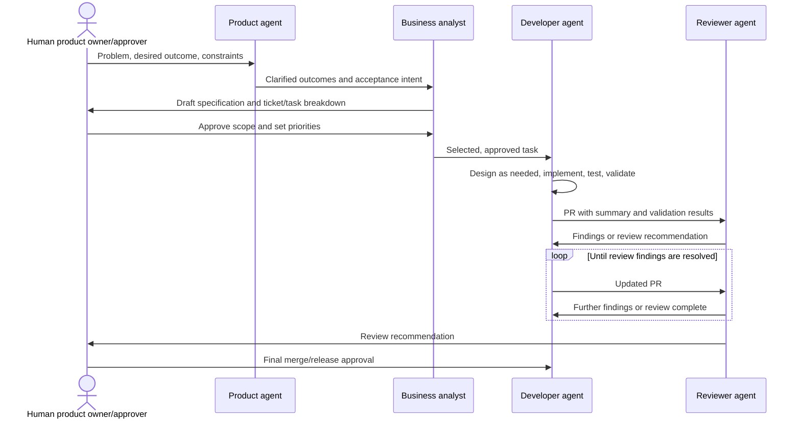

# From agile roles to agent-assisted workflows

This page offers an optional, higher-cost perspective on how familiar agile activities might be organized in an agent-assisted software factory. It is not a first-step setup guide: begin with one agent and a human reviewer, and consider separate roles only when recurring work has distinct, reviewable handoffs. The examples below illustrate one possible arrangement, not a prescribed workflow or a prediction of how teams will work in future.

In a familiar agile process, people may clarify requirements, plan and implement work, review results, and decide whether to release. This example assigns some of those activities to agents with distinct roles, while people retain decisions and approval. The intended benefit is to avoid asking one agent to carry out a large, open-ended undertaking: smaller loops produce outputs that can be reviewed and provide points for human intervention.

The mapping is a way to reason about a transition, not evidence that these exact roles are necessary or that the approach improves outcomes. Teams and agile practices vary; the activities and their assignment may change as agent capabilities evolve. For an account of one actual exercise, see the [lo-fi software factory case study](lo-fi-software-factory-case-study.md).

## Roles and boundaries in this example

The example distinguishes what each role is expected to do from what is out of bounds. Its role contracts describe:

- **Purpose:** the outcome the role exists to produce.
- **Expected responsibilities:** the work and decisions it owns or contributes to.
- **Limits:** work it must not perform, decisions it cannot make, and conditions that require a handoff.
- **Inputs and outputs:** what it needs and what it should return to the next role.

These boundaries are part of a role's profile or instructions, rather than being implied by the title. They are also [instructions, not automatically enforced controls](../concepts/instructions-vs-controls.md); enforcement depends on actual permissions and other controls.

## RACI and workflow relationships

RACI can map who is **Responsible**, **Accountable**, **Consulted**, and **Informed** for activities across a multi-agent workflow. It helps show ownership and handoffs between roles.

RACI does not, by itself, define every prohibition. An empty cell or an “Informed” assignment does not necessarily mean a role is forbidden to act. In this example, the role contracts state off-limits work and RACI supplies a complementary workflow view.

For example, a product role might not implement code, a reviewer might evaluate changes without implementing them, and a business analyst might not perform code review. These are illustrative boundaries, not universal definitions of those roles.

## Example role contracts

These short contracts illustrate the example roles' responsibilities and limits; they are not canonical definitions.

### Product agent

- **Expected:** clarify the problem, desired outcome, constraints, and acceptance intent; advise on priority.
- **Out of scope:** implementing code, reviewing code, and giving final merge or release approval.
- **Hands off:** an agreed product direction and acceptance intent to the Business Analyst; prioritization decisions to the human product owner.

### Business analyst

- **Expected:** elicit and organize requirements, draft the spec, and decompose approved scope into tickets or tasks.
- **Out of scope:** code review in this workflow.
- **Hands off:** the spec and task breakdown for human approval and prioritization.

### Developer agent

- **Expected:** implement an approved task, add or update tests, run validation, create or update the PR, and address review findings.
- **Out of scope:** changing the agreed product priority or granting final merge or release approval.
- **Hands off:** the PR with a summary and validation results to the Reviewer.

### Reviewer agent

- **Expected:** assess the PR against the requirements and code standards; report findings and a review recommendation.
- **Out of scope:** implementing the change or giving final merge or release approval.
- **Hands off:** the review recommendation to the human approver; findings to the Developer for resolution.

### Human product owner/approver

- **Expected:** set or confirm priorities, approve product scope, and make the final merge or release approval decision.
- **Out of scope:** none prescribed in this example; actual human responsibilities and delegated authority vary by workflow.

## Illustrative delivery-workflow RACI

This example shows one possible division of work, not a prescribed role model. It includes a human product owner/approver because prioritization and final merge/release approval remain human-led in this example.

**R** = Responsible for doing the work; **A** = Accountable for the outcome; **C** = Consulted; **I** = Informed. A blank means “not assigned in this example,” not “prohibited.” The role contracts state prohibitions separately.

| Activity                                                | Product agent | Business analyst | Developer agent | Reviewer agent | Human product owner/approver |
| ------------------------------------------------------- | ------------- | ---------------- | --------------- | -------------- | ---------------------------- |
| Clarify problem, desired outcome, and acceptance intent | R             | C                | I               | I              | A                            |
| Elicit requirements and draft the spec                  | C             | R                | C               | I              | A                            |
| Approve the spec and scope                              | C             | C                | I               | I              | R/A                          |
| Decompose approved scope into tickets/tasks             | C             | R/A              | C               | I              | I                            |
| Prioritize and assign work                              | C             | C                | I               | I              | R/A                          |
| Propose technical design or an ADR, when needed         | C             | C                | R               | I              | A                            |
| Implement the task and tests                            | I             | C                | R/A             | I              | I                            |
| Run validation and report results                       | I             | I                | R/A             | I              | I                            |
| Create or update the PR                                 | I             | I                | R/A             | I              | I                            |
| Review the PR against requirements and code standards   | I             | I                | C               | R/A            | I                            |
| Address review findings                                 | I             | I                | R/A             | C              | I                            |
| Approve merge/release                                   | C             | I                | I               | C              | R/A                          |

This example keeps the Product agent focused on outcomes rather than implementation, the Business Analyst on requirements and decomposition rather than code review, and the Reviewer on assessment rather than implementation. The review considers requirements as well as test output: [passing tests are evidence, not proof](../concepts/tests-are-evidence.md). The human retains prioritization and final approval. Repositories may assign the mechanics of merging or releasing separately according to their policies.

## Illustrative handoff flow

The sequence diagram shows the order of work and review loop; the RACI table shows activity ownership. The diagram is Mermaid source so agents can inspect the relationships directly, in addition to the rendered view.

The flow is illustrative: task selection, merge execution, and release mechanics may differ by repository. In this example, the role limits still apply even where the diagram omits a role from a handoff.

## Responsibility and authority

The example separates doing the work from having authority to approve it. A role may prepare an analysis or recommendation without being the final decision-maker; the human remains accountable for the decisions shown.

See [skills, profiles, and tools have different jobs](../concepts/skills-profiles-and-tools.md) for how role profiles relate to reusable skills.
