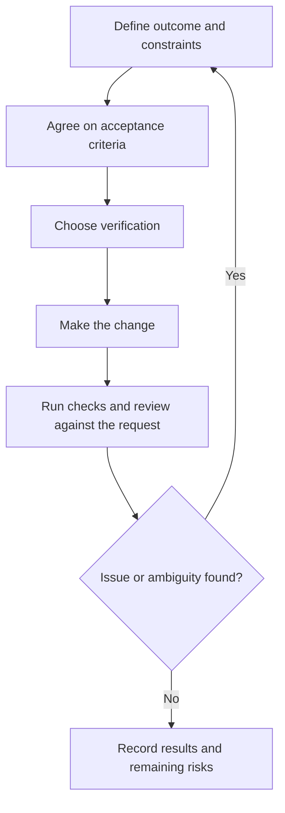

# Define and verify a task

A clear request gives an agent a better chance of producing the intended result. Recording the request and its verification also makes the work easier to review. Start small: a short task description may be enough, while ambiguous or consequential work can justify a fuller specification.

## Try this first

1. **Write the outcome.** State the problem, who or what is affected, and any important constraints or out-of-scope work.
2. **Agree on acceptance criteria.** Describe observable behaviors, including important failure cases. Resolve material ambiguity before implementation.
3. **Choose verification.** Identify the relevant existing checks and any focused test, manual check, or review needed to assess the criteria.
4. **Review and record the result.** Compare the change with the request; record what was checked, the outcome, and any assumptions or unchecked risks in the issue, PR, or another durable artifact appropriate to the task.

One possible loop is to clarify the work, choose checks, make the change, then review and record the result. Revisit earlier decisions when the work exposes a problem or ambiguity.

For example, “reject expired credentials” needs a check that expired credentials are actually rejected, not only a successful-login test. Record the expected rejection behavior and use a focused test where appropriate; review the change and any remaining security implications before approval.

## Example: from request to review

These fictional issue and PR notes illustrate a small task; they are not results from an actual test run.

**Issue:** Reject expired credentials without changing successful authentication for valid credentials.

- **Acceptance:** Expired credentials are rejected and do not create an authenticated session.
- **Acceptance:** Valid credentials continue to authenticate.
- **Verification:** Run focused tests for both behaviors; review the rejection path and any checks that could not be run.

**PR notes:** Links to the issue and summarizes the change to reject expired credentials. In this example, focused tests for both acceptance criteria passed, but the integration check was not run because its test service was unavailable. The reviewer needs that missing evidence before deciding whether the change is ready.

## Scale the process to the work

For a small change, the outcome, criteria, and checks may fit in an issue or PR description. For larger work, an agreed specification can capture decisions and acceptance intent before it is broken into tasks. Link existing artifacts so a reviewer can follow the work: for example, connect the issue to its PR and record the checks and results in the PR. A multi-agent role structure is not required.

Verification should be independent enough to catch a shared mistaken assumption in the implementation and its tests. [Passing tests are evidence, not proof](../concepts/tests-are-evidence.md); use [unit tests as focused feedback](unit-tests-in-the-age-of-ai.md) alongside other checks suited to the risk.

## Explore further

- [Evals](../concepts/evals.md) compare agent behavior across representative tasks when repeatable assessment is useful.
- [From agile roles to agent-assisted workflows](agent-role-boundaries.md) offers a perspective on handoffs and approvals in an illustrative workflow.
- [Sensitive data in agent workflows](sensitive-data-in-agent-workflows.md) covers access, data flow, and safeguards before and during a task.
