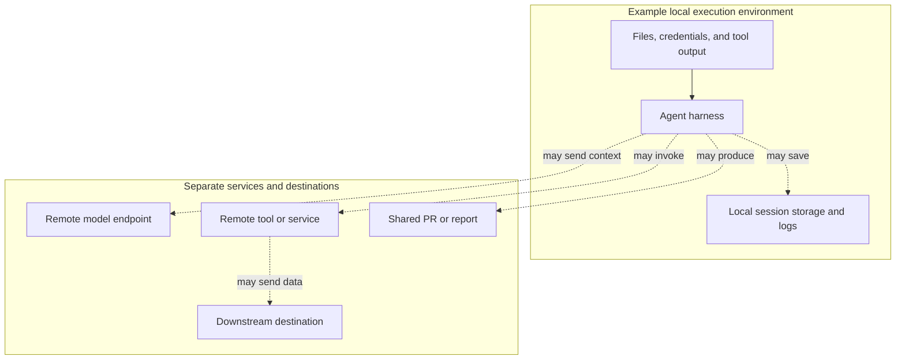

# Sensitive data in agent workflows

**Developing:** The guide outlines controls, but practical techniques and examples for handling untrusted content need more development.

Using an agent safely requires understanding both what it can access and what it can do. Through [the tool-call loop](../concepts/tool-call-loop.md), file contents and tool results can become model input or further actions. A locally installed harness may use remote inference and services; local inference does not by itself prevent exposure through other routes.

This guide explains the common data-flow model for AI-assisted software work, not the full subject of securing AI-powered applications. See [How models and harnesses interact](model-harness-interaction.md) for the underlying interaction loop; use the [data-flow checklist](agent-data-flow-checklist.md) for an operational review of a particular setup.

## Start with the actual data flow

Before using sensitive material, identify what the agent can access and where its context or tool results may go. Use the [data-flow checklist](agent-data-flow-checklist.md) to record flows, resolve unknowns, and verify controls in the actual harness and environment. The right safeguards depend on risk; do not defer essential controls because they require more effort.

## The main risks

| Risk                   | What can go wrong                                                                                                 |
| ---------------------- | ----------------------------------------------------------------------------------------------------------------- |
| Data exposure          | Secrets, private code, or personal data reach unintended services, logs, or shared artifacts.                     |
| Unintended actions     | An agent deletes files, changes infrastructure, spends money, or publishes material without appropriate approval. |
| Prompt injection       | Instructions embedded in issues, files, web pages, or tool results steer the agent into misusing its access.      |
| Unsafe changes         | Generated code introduces vulnerabilities or weakens tests, access controls, or other safeguards.                 |
| Untrusted integrations | Tools, skills, dependencies, or MCP servers execute code or access data beyond what is expected.                  |

These risks overlap. Prompt injection can cause data exposure or destructive actions; a compromised integration can do both. The impact grows with the agent's accessible data, permissions, and autonomy. OWASP describes this relationship in its guidance on [prompt injection](https://genai.owasp.org/llmrisk/llm01-prompt-injection/) and [excessive agency](https://genai.owasp.org/llmrisk/llm062025-excessive-agency/).

## What data might be sensitive?

| Data                                                                                                | How it may enter the workflow                                                                                                               |
| --------------------------------------------------------------------------------------------------- | ------------------------------------------------------------------------------------------------------------------------------------------- |
| Credentials: API tokens, private keys, cookies, connection strings, environment variables           | Reading configuration; commands that print environment or credential data; test failures and debug output.                                  |
| Private code and plans: source, internal documentation, unreleased designs                          | File reads, workspace search or indexing, attached diffs, pasted prompts, or automatically selected editor context.                         |
| Personal or customer data: support tickets, application logs, production records, test fixtures     | Investigating real cases; querying logs, databases, or issue trackers; copying production data into tests.                                  |
| Security-sensitive information: vulnerabilities, incident details, architecture, internal endpoints | Security investigations, code scans, tool output, and threat-model discussions.                                                             |
| Derived information: generated summaries, code, test results, and reports                           | The agent repeats, combines, or transforms sensitive information it has received. A summary is not necessarily anonymized or safe to share. |

Sensitivity depends on context and organizational policy. An internal endpoint may be harmless in one setting and confidential in another.

## Where data can go, how, and what to control

The destinations below are possibilities, not claims that every product sends data to all of them. Trace the actual harness, account, model endpoint, and enabled integrations.

This example shows a local harness crossing into separate services and destinations. Other setups may run the model or tools locally, and local tools can also send data elsewhere. Check each destination and its actual access or network boundary.

Three examples show why the destination matters:

| Route                                   | How exposure can happen                                                                  | Control to consider                                                                              |
| --------------------------------------- | ---------------------------------------------------------------------------------------- | ------------------------------------------------------------------------------------------------ |
| Tool output to model or session history | A diagnostic prints a token, and the harness includes the output in context or saves it. | Avoid printing secrets; limit accessible credentials and verify logging and retention.           |
| Agent to external tool or service       | A tool call sends private source or log data to an unexpected endpoint.                  | Review enabled integrations, their data destinations, and enforced network or permission limits. |
| Agent to shared artifact                | A generated report, commit, or PR contains confidential data.                            | Inspect diffs and outputs before sharing; use appropriate scanning and publication review.       |

The [data-flow checklist](agent-data-flow-checklist.md#check-each-destination) gives the fuller destination-specific questions for model providers, local storage, cloud history, tools, artifacts, and unintended destinations. Assess [inference, retention, and training separately](../concepts/inference-retention-training.md): a no-training policy is not a no-transmission or no-retention guarantee. [Saved history also differs from active model context](../concepts/session-history-vs-context.md), so reducing context is not evidence that stored data has been deleted.

### Local and remote MCP servers

Local servers execute on your machine; remote servers receive supplied data on another system. **Either can make further network requests** if permitted. [Local MCP does not mean local-only data](../concepts/local-and-remote-mcp.md) explains the different access risks and why downstream destinations must also be checked.

### Exposure without an explicit upload

An ordinary diagnostic can print a credential, which may then enter history, a later model request, and a shared transcript. [Secrets can leak through tool output](../concepts/secrets-in-tool-output.md) traces this accidental flow and explains why redacting after transmission is too late.

## Choose controls for the execution environment

Use the [local-agent guide](local-agent-security.md) or [cloud-agent guide](cloud-agent-security.md) for environment-specific permissions, credentials, and approval boundaries. The [data-flow checklist](agent-data-flow-checklist.md) is the reusable operational review; [prompt-injection guidance](prompt-injection-coding-agents.md) explains how untrusted content can misuse access.

Controls should be enforced where possible, not just described in instructions: [a worktree is not a sandbox](../concepts/worktrees-not-sandboxes.md), and local shell restrictions may not cover remote integrations. If a secret is exposed, follow [the tool-output containment guidance](../concepts/secrets-in-tool-output.md#reduce-exposure-at-the-source) and account for copies beyond visible text.

Keep enough of a record to support review without reproducing sensitive inputs; inspect outputs before sharing them.

## References

- [OWASP: Prompt Injection](https://genai.owasp.org/llmrisk/llm01-prompt-injection/) — untrusted inputs, possible impacts, and layered mitigations.
- [OWASP: Excessive Agency](https://genai.owasp.org/llmrisk/llm062025-excessive-agency/) — risks from excessive functionality, permissions, and autonomy.
